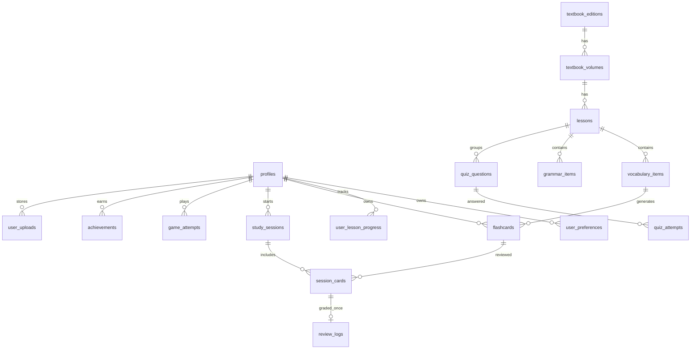

# Nihongo Quest — Database Specification

## Nguyên tắc và ERD
Supabase PostgreSQL, UUID PK, UTC `timestamptz`. RLS toàn bộ 17 bảng; dữ liệu cá nhân owner-scoped. Storage bucket private. Catalog chỉ metadata.

## 17 bảng
1. `profiles`: id FK auth.users, display_name, avatar_path, created_at, updated_at.
2. `user_preferences`: user_id unique FK profiles, edition_id, volume_id, daily_goal, review_reset_hour, timezone, answer_mode (`kana|kanji|flexible`), timestamps.
3. `textbook_editions`: slug unique, title, publisher_label, language_pair, is_active, sort_order.
4. `textbook_volumes`: edition_id, volume_number, title, sort_order; unique edition/number.
5. `lessons`: volume_id, lesson_number (1–50), title, sort_order, is_active; unique volume/number.
6. `user_lesson_progress`: user_id, lesson_id, status, vocabulary_done, grammar_done, quiz_best_score, completed_at, updated_at; unique user/lesson.
7. `vocabulary_items`: user_id, lesson_id, japanese, kana, meaning, part_of_speech, example_japanese/meaning, source_note, timestamps.
8. `grammar_items`: user_id, lesson_id, pattern, explanation, examples, source_note, sort_order, timestamps.
9. `flashcards`: user_id, vocabulary_id nullable, lesson_id, prompt_japanese/kana, accepted_answers[], meaning, mode, fsrs_state, due_at, stability, difficulty, last_review_at, reps/lapses, suspended_at, timestamps.
10. `study_sessions`: user_id, session_type, lesson_id nullable, status, started_at, ended_at, cards_seen, correct_count, metadata jsonb.
11. `session_cards`: session_id, flashcard_id, position, attempt_index, typed_answer, is_correct, rating, graded_once, srs_applied_at; unique session/card for canonical grade.
12. `review_logs`: user_id, flashcard_id, session_card_id unique, rating, answer, is_correct, elapsed_ms, scheduled_days, previous_due_at, reviewed_at.
13. `quiz_questions`: user_id, lesson_id, prompt, question_type, options jsonb, accepted_answers[], explanation, difficulty.
14. `quiz_attempts`: user_id, session_id, question_id, answer jsonb, is_correct, elapsed_ms, attempted_at.
15. `game_attempts`: user_id, session_id, game_type, lesson_id, payload jsonb, is_correct, score, duration_ms, created_at.
16. `achievements`: user_id, achievement_key, unlocked_at, metadata; unique user/key.
17. `user_uploads`: user_id, bucket, object_path, media_type, size_bytes, created_at; unique bucket/path.

## Constraints / business validation
- daily_goal 1–200; reset hour 0–23; lesson 1–50; nonnegative counters/sort/duration; quiz score 0–100; checked enum values; size positive.
- Prompt ≤500 chars, meaning ≤2000, examples ≤2000; MIME/size allowlist on upload endpoint.
- User/session/card composite ownership checked in trusted transaction/RPC; client cannot attach another user's identifiers.
- Unique review log per session_card_id. Grade transaction checks `graded_once`, inserts immutable log, applies scheduler and due update atomically.
- NFKC, trim/collapse whitespace; mode-specific kana handling; never strip meaningful kanji. Accepted aliases user-authored.
- Persist scheduler version; session retries update attempt feedback only and never schedule twice.

## Indexes
Volumes `(edition_id,sort_order)`; lessons unique `(volume_id,lesson_number)` + `(volume_id,sort_order)`; progress unique `(user_id,lesson_id)` and `(user_id,status)`; vocab `(user_id,lesson_id)`; grammar `(user_id,lesson_id,sort_order)`; flashcards partial `(user_id,due_at) WHERE suspended_at IS NULL` and `(user_id,lesson_id)`; sessions `(user_id,started_at DESC)`; session_cards `(session_id,position)` + unique session/card; logs `(user_id,reviewed_at DESC)` and `(flashcard_id,reviewed_at DESC)` + unique session_card_id; quiz/game attempts owner/time; uploads `(user_id,created_at DESC)` + unique bucket/path.

## RLS
- Enable RLS on all 17 tables.
- Profiles only `id=auth.uid()`; personal tables `USING(user_id=auth.uid()) WITH CHECK(user_id=auth.uid())`.
- Edition/volume/lesson metadata: authenticated SELECT active rows; write migration/admin only.
- `session_cards` checks ownership through parent study_sessions; review logs owner-readable, grade insert through trusted RPC.
- User-authored quiz questions private. Shared curated bank requires separate reviewed catalog.
- Private `user-content` Storage bucket; object path `<auth.uid()>/...`; CRUD limited to owner prefix.
- No service role in browser. Anonymous user uses local demo only.

## API / server action contract
- `POST /auth/callback`: auth code exchange + cookie session.
- `GET/PUT /api/preferences`; `GET /api/lessons?edition=&volume=`.
- `GET/POST/PATCH /api/lessons/:id/vocabulary` and `/grammar`.
- `POST /api/study-sessions`.
- `POST /api/study-sessions/:id/cards/:cardId/answer`: record attempt only.
- `POST /api/study-sessions/:id/cards/:cardId/grade`: calls the migration's `grade_session_card` RPC for an atomic/idempotent FSRS transaction.
- `GET /api/review/due`, `/api/review/mistakes`.
- `POST /api/quiz-attempts`, `/api/game-attempts`.
- `POST/DELETE /api/uploads`: validate MIME/size and scope Storage.
MVP UI uses demo repository. Live auth/persistence requires user Supabase credentials.

## Acceptance criteria
1. Fresh migration creates exactly 17 domain tables with constraints, indexes, timestamps, RLS.
2. Seed has 50 lesson metadata slots per edition, partitioned across volumes and keyed by edition/volume; no textbook excerpts.
3. Two users cannot access each other's rows or Storage objects.
4. Typed recall required; miss→Again once; retry creates no duplicate SRS update; correct needs Hard/Good/Easy.
5. Kana/Kanji/Flexible normalization honors Japanese IME composition.
6. Due query uses timezone/reset, due_at and unsuspended state.
7. Server validates ownership/bounds; no secret appears in API/client.
8. Demo works without Supabase; persistence requires user project configuration.
